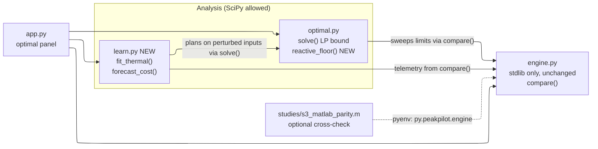

# ML models (SciPy and MATLAB) — Design

Issue: [#15](https://github.com/sohampatwardhan/PeakPilot/issues/15). Validates `requirements.md` in this folder. Evidence: `studies/ml_studies.ipynb` (executed; every figure below
comes from it) and `studies/results/*.json`. Everything is SIMULATED.

## Overview

A new module, `peakpilot/learn.py`, holds the two learned pieces: thermal calibration and forecast-error costing.
`optimal.py` gains the reactive-floor search. Both call the engine and the existing LP and never schedule
anything themselves. `app.py` renders three additions inside the existing "How close to optimal?" panel.
`engine.py` is not touched.



### Deployment boundary

The Raspberry Pi image (`rust/peakpilot-core/Dockerfile`, CI job "Raspberry Pi 4/5 image") simulates what would
run on the Pi. Its build context is that folder alone, and the runtime image is `scratch` with one static binary.
Nothing in this feature goes there (R4.5). The studies under `studies/` are research run on the development
machine. `learn.py` and the panel additions are part of the Python dashboard. The CI image job needs no change.

## Research: what each tool offers for ML here

### SciPy 1.17.1 (already pinned)

SciPy has no estimator API like scikit-learn's, but every model these studies need is a least-squares or
linear-algebra problem it solves directly:

| Need | SciPy routine | Used in |
|---|---|---|
| Linear / ridge regression, ARX | `scipy.linalg.lstsq`, `scipy.linalg.solve(assume_a="pos")` | S1 EE fit, S2 ridge forecast |
| Grey-box nonlinear fit (simulate-and-compare) | `scipy.optimize.least_squares` (bounds, TRF) | S1 OE fit |
| Small neural network | `scipy.optimize.minimize(method="L-BFGS-B")` on a hand-written loss | not needed; noted only |
| Clustering, kernel density | `scipy.cluster.vq.kmeans2`, `scipy.stats.gaussian_kde` | not needed |
| Planning with a model | `scipy.optimize.linprog(method="highs")` | existing `optimal.py`; S2 plans |

Every fit in the studies runs in under 4 ms. Nothing needs scikit-learn or PyTorch, so no new runtime dependency
is added.

### MATLAB R2026b (on the study machine)

Installed: MATLAB, Optimization Toolbox, Simulink, Simscape, Simscape Electrical. The licence allows Statistics
and ML, System Identification, Deep Learning, Compiler and Coder, but **none of them are installed**. S3 therefore
uses only `mldivide` and `lsqnonlin`, which any MATLAB with the Optimization Toolbox has.

| Path | Judge needs MATLAB? | Verdict |
|---|---|---|
| Train offline in MATLAB, export coefficients (JSON/CSV), infer in Python | No | Viable, but for these linear models it adds nothing over SciPy |
| Compiler SDK Python package + MATLAB Runtime | No, but needs a multi-GB Runtime matching the release; academic-licence redistribution unclear | Reject |
| MATLAB Engine API (`matlabengine` 26.2.x, Python 3.10–3.14) at runtime | Yes, licensed | Reject: breaks "free of charge, without restriction" |
| MATLAB calling Python (`pyenv`, `py.peakpilot.engine`) | No (dev only) | **Keep** as the cross-check: MATLAB drives the real engine, so there is still one source of truth |
| MATLAB Coder → C for `predict` (needs Statistics and ML + Coder) | No | Not planned: the Pi runs only the Rust engine, and no learned model goes there (R4.5) |
| GNU Octave + oct2py | No | Has `fitlm`/`fitrgp` (statistics pkg 2.0.1) and `arx`, but no `greyest`/`ssest`; not needed |

Sources: MathWorks Python compatibility table, Engine API install docs, MATLAB Runtime and Compiler support pages,
`loadLearnerForCoder` and `exportONNXNetwork` reference pages (all checked 2026-10-24). Unverified: Runtime size on
Apple silicon, and per-function Compiler support for `greyest`/`ssest`.

### Prior decisions (Kiro sessions, 2026-10-24)

Kiro's earlier sessions put "ML-based control" out of scope: a deterministic, explainable scheduler is the
contribution, there is no real telemetry, and a model trained on simulated data would only learn to imitate the
simulator. Kiro named forecasting inputs and fitting thermal parameters as the right places for ML, after an optimal
solve. It advised against MATLAB because judges and CI can't run it. This design follows all of that: ML is
analysis, and MATLAB is a cross-check.

## Studies and results

### S1 — thermal identification (`s1_thermal_id.py`)

The engine's room model is linear in `a = 1/(R·C)` and `b = eta/C`:
`T[t+1] = T[t] + a·(out[t] − T[t]) − b·u[t]`, verified against engine output to 4e-15 °C. The study trains on Hot
evening (31 °C peak), tests free-run prediction on a 34 °C evening, and adds seeded noise of 0–0.2 °C.

| Noise | Train | EE a / b err | OE a / b err | EE test RMSE | OE test RMSE |
|---|---|---|---|---|---|
| 0.05 °C | 240 min | +0.1 / +0.1 % | +0.2 / +0.3 % | 0.005 °C | 0.004 °C |
| 0.2 °C | 240 min | −1.2 / −1.6 % | +0.4 / +0.5 % | 0.038 °C | 0.007 °C |
| 0.2 °C | 960 min | +1.9 / +0.6 % | +0.2 / +0.3 % | 0.091 °C | 0.004 °C |
| untuned guess (±30 %) | — | — | — | up to 6.03 °C | |

Downstream, the LP bound on the test evening is 6.285 kW with the true model and with the OE fit. With the
untuned guesses it ranges from 5.976 to 7.298 kW (−4.9 % to +16.1 %). **Design decision:** use OE seeded by EE.
EE alone gets worse with more data at 0.2 °C noise because it regresses on noisy readings.

### S2 — value of foresight (`s2_forecast_value.py`)

Hot evening: the **reactive floor is 7.8 kW** and the **perfect-foresight bound is 6.03 kW**. An LP plan built on
a perturbed forecast and played open-loop against the truth reaches:

| Forecast error | Realized peak | Comfort-violation min |
|---|---|---|
| none | 6.03 kW | 0 |
| base load ×0.9 / ×1.1 / ×1.2 | 6.15 / 6.08 / 6.13 | 0 |
| ±30 min timing | 6.35–6.38 | 0 |
| ±60 min timing | 6.65–6.71 | 0 |
| noise 0.2 kW / 0.5 kW | 6.79 / 7.88 | 0 |
| outdoor −2 °C / +2 °C | 5.85 / 6.24 | **462** / 0 |

On 30 synthetic held-out evenings, the average excess over perfect foresight is 0.69 kW for persistence, 0.49 kW
for climatology and 0.45 kW for ridge on the outdoor peak (MAE 0.41 / 0.37 / 0.14 kW). The synthetic generator
built that relationship in, so the ridge result only checks the pipeline. **Design decisions:**

- Headline the reactive floor, not the gap to the chosen limit. This answers the Kiro dashboard review's item 8 ("a
  skimming judge may read the gap as PeakPilot is far from optimal").
- Show forecast *error cost*, not a trained forecaster. We have no real history to train on.

### S3 — MATLAB parity (`s3_matlab_parity.m`)

| Quantity | MATLAB vs SciPy max abs diff |
|---|---|
| EE `a`, `b` | 5.3e-9 |
| OE `a`, `b` (`lsqnonlin` vs `least_squares`) | 1.3e-9 |
| Ridge test MAE | 8.0e-8 kW |
| Engine called from MATLAB via `pyenv` (Python 3.12, out-of-process), room series vs CSV | 5.0e-7 °C (CSV rounding) |

### Finding outside this feature: EV-offline feasibility

In the EV-offline scenario, feasibility is **not monotone in the limit**. On the 0.1 kW grid, the coordinated run
meets every constraint only at 14.9–15.4 kW and at 19.0 kW and above. Sampled every 0.5 kW, it goes over the limit by
1–7 minutes at 15.5–18.5 kW, and by 25 minutes at its own 14 kW limit. The engine holds the EV's last commanded power while the
charger is offline, and the scheduler does not plan ahead for the outage. This feature only *reports* it (R1.2).
Whether the scheduler should plan for a known outage belongs in a separate issue.

## Public API

### `peakpilot/optimal.py` (additions)

```python
@dataclass(frozen=True)
class ReactiveFloor:
    limit_kw: float | None          # lowest feasible grid limit; None if none
    peak_kw: float | None           # coordinated peak at that limit
    monotone: bool                  # every grid limit above limit_kw is also feasible
    grid_kw: tuple[float, float, float]  # (start, stop, step) actually searched
    def to_json_dict(self) -> dict: ...

def reactive_floor(scenario: Scenario, step_kw: float = 0.1) -> ReactiveFloor: ...
```

The search runs every grid limit from 5.0 kW to `ceil(baseline peak)`: 151 engine runs, measured at 0.49–0.52 s
for every named scenario. It scans the whole grid instead of bisecting, because bisection assumes monotonicity, which EV
offline breaks. `Benchmark` gains `floor: ReactiveFloor`, `headroom_kw = floor.limit_kw − bound` and `headroom_pct`.

### `peakpilot/learn.py` (new; SciPy)

```python
@dataclass(frozen=True)
class ThermalFit:
    params: ThermalParams           # C kept from the prior; R = 1/(a·C), eta = b·C
    a: float; b: float; start_c: float
    rmse_c: float                   # in-sample free-run RMSE, °C
    ac_on_min: int
    method: str                     # "output-error (least_squares), EE-seeded"

def fit_thermal(room_c, outdoor_c, ac_kw, prior: ThermalParams = ThermalParams()) -> ThermalFit: ...
def simulated_telemetry(scenario: Scenario, noise_c: float = 0.2, seed: int = 20261024) -> tuple[list, list, list]: ...

@dataclass(frozen=True)
class ForecastError:
    scale: float = 1.0              # base-load multiplier, 0.8–1.2
    shift_min: int = 0              # +late / −early, −60..60
    noise_kw: float = 0.0           # seeded Gaussian, 0–0.5
    outdoor_bias_c: float = 0.0     # −3..3
    seed: int = 20261024

@dataclass(frozen=True)
class ForecastCost:
    status: str                     # mirrors OptimalResult.status
    planned_peak_kw: float | None
    realized_peak_kw: float | None
    comfort_violation_min: int | None

def forecast_cost(scenario: Scenario, error: ForecastError) -> ForecastCost: ...
```

The study code in `studies/s1_thermal_id.py` and `studies/s2_forecast_value.py` is the reference implementation.
`learn.py` uses plain Python lists at its boundaries, like `optimal.py`. The study scripts stay as they are, since
they are the evidence, and the tests check that `learn.py` reproduces their numbers.

## Validation and error handling

| Condition | Behavior | Caller gets |
|---|---|---|
| `fit_thermal`: unequal lengths, < 60 points, or no AC-on minutes | programmer/data error | `ValueError` with the reason |
| `least_squares` does not converge (`status ≤ 0`) | recoverable | the EE estimate, with `method` saying so |
| `ForecastError` field out of range | programmer error | `ValueError` |
| LP infeasible / error inside `forecast_cost` | recoverable | `status` passed through, numbers `None` |
| `reactive_floor` finds no feasible grid limit | expected outcome | `limit_kw=None` |

## UI (`app.py`, after PR #14 merges)

Inside the existing "How close to optimal? (SIMULATED)" container:

1. **Metrics row:** reactive floor kW · lower bound kW · headroom kW and %, replacing the coordinated-peak / gap row.
   The current gap moves to the caption. Show R1.2 / R1.3 notes when they apply.
2. **"What if the forecast is wrong?"** expander: four sliders (scale, shift, noise, outdoor bias), the realized
   peak against the floor and the bound, plus R3.4 / R3.5 text.
3. **"Calibrate the room model"** expander: fit the SIMULATED telemetry, show true vs fitted `R` and `eta`, RMSE,
   and a toggle "Use calibrated room model" that rebuilds the scenario's `thermal` (R2.6).

Each result is cached with `st.cache_data(hash_funcs={Scenario: repr})`, as `_benchmark` already is.

## Testing

| File | What |
|---|---|
| `tests/test_learn.py` | Hypothesis PBT for `fit_thermal` recovery (R6.1); `ValueError` cases; determinism; reproduces S1's 0.2 °C / 240 min row within 1e-9 |
| `tests/test_learn.py` | `forecast_cost` with zero error equals the LP bound with 0 violation minutes (R6.3); reproduces the S2 Part A table (AC 4) |
| `tests/test_optimal.py` | `reactive_floor`: Hot evening 7.8 kW, EV offline 14.9 kW with `monotone=False`, Infeasible 11.7 kW, an unreachable-deadline scenario returns `None` (R6.2) |
| `tests/test_app.py` | panel shows "Reactive floor", the two expanders render, the calibration toggle changes the room model label |

Hypothesis joins the `test` extra in pyproject (pin the then-current release). This also gives the Kiro write-up a
concrete PBT answer.

## Risks

- **Judges may read "ML" as overclaiming.** Mitigation: the word "learned" appears only next to SIMULATED, and the
  panel says the controller is unchanged.
- **A dashboard rerun sweeps 151 engine runs (~0.5 s).** Mitigation: cache it on the scenario.
- **The PR #14 merge order.** `app.py` changes here must rebase on `main` after #14 lands, to avoid conflicts in
  the panel and metric code.
