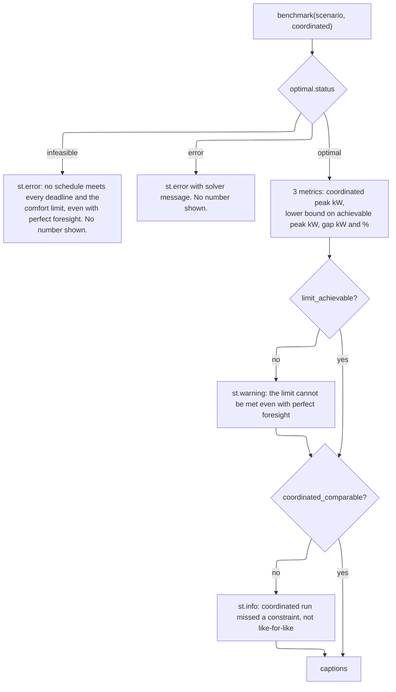

# Optimal benchmark — Design

Issue: [#9](https://github.com/sohampatwardhan/PeakPilot/issues/9). Validates `requirements.md` in this folder.

## Overview

A new module `peakpilot/optimal.py` turns a `Scenario` into one linear program (LP), solves it
with `scipy.optimize.linprog(method="highs")`, and returns the lowest peak kW that any schedule
could reach while delivering the same work. `app.py` calls it next to `engine.compare()` and
renders a separate "How close to optimal?" panel. `engine.py` is not touched. Stack: Python 3.11+,
SciPy 1.17.1 (HiGHS), plus the existing Streamlit 1.40.2. SciPy and Streamlit API details are
verified against Context7 docs during implementation (`/scipy/scipy`, `/streamlit/docs`).

## LP formulation (derived from `engine.py`)

Indices: devices `d` in `scenario.devices`, minutes `t = 0..959` (`N = WINDOW_MINUTES`).

**Variables** (3,841 total): `p[d,t]` device power in kW (3 × 960), `T[t]` room °C (960), `P` peak kW (1).

**Objective:** minimize `P`.

**Constraints:**

| Rule | Encoding | Engine source |
|---|---|---|
| Peak | `Σ_d p[d,t] − P ≤ −base_load[t]` for every `t` (960 `A_ub` rows) | `total_kw = base + Σ device kW` |
| Power limits | bounds `0 ≤ p[d,t] ≤ max_kw` | `DeviceSpec.max_kw` |
| Energy by deadline | `Σ_{t<D} p[d,t] / 60 = target_kwh` (1 `A_eq` row per energy device) | `delivered_kwh += kW/60` |
| Nothing after deadline | bounds `p[d,t] = 0` for `t ≥ D` | engine stops once the target is met |
| Offline hold | `p[d,t] − p[d,s−1] = 0` for `t ∈ [s,e)`; bounds `p = 0` if `s = 0` | coordinated run holds last commanded kW (R4.2 of base spec) |
| Thermal | `T[t+1] − (1−a)·T[t] + b·p_ac[t] = a·outdoor_c[t]` for `t = 0..958` | `_step_room_temp` |
| Start | bounds `T[0] = start_c` | `room_c = thermal.start_c` |
| Comfort | bounds `T[t] ≤ comfort_c`, no lower bound | `temp_violation_min` counts `room_c[0..959]` |

`_step_room_temp` reduces to `T' = T + ((out − T)/r − u·eta)/c` because `dt·60 = 1`. So
`a = 1/(r·c) = 1/14.4` and `b = eta/c = 3.2/9 ≈ 0.356 °C per kW·min` with default `ThermalParams`.
This is linear, so the thermal model maps exactly with no approximation. Equality is used for energy
so the LP does exactly the same work as the engine (no over-delivery). `P` has bounds `(None, None)`.
The power limit is not a constraint. Only the first AC cools, as in `engine._ac_spec`.

Constraint matrices are built as `scipy.sparse` CSR. A prototype on this branch solved every named
scenario in about 0.03 s:

| Scenario | Coordinated peak | LP bound |
|---|---|---|
| Hot evening (14 kW) | 14.00 | 6.03 |
| Tight limit (11 kW) | 11.00 | 6.03 |
| EV offline | 14.29 | 6.03 |
| Infeasible (8 kW) | 14.91 | 10.53 |

The gap is large on easy limits because the scheduler aims to stay under the limit, not to minimize
the peak. The panel says so.

## linprog, not milp: what the LP relaxes

`linprog` is enough. A MILP would need about 1,920 binaries plus minimum-run constraints for the
water heater and AC, with unknown solve time, and it is out of scope. The LP relaxes:

1. Water heater: on/off at 4.5 kW with a 15-min minimum run becomes continuous 0–4.5 kW.
2. AC: on/off at 3.5 kW with a 10-min minimum run becomes continuous 0–3.5 kW.
3. An offline AC counts its held power as cooling. The engine gives no cooling while the AC is
   offline. No named scenario has an offline AC.

The EV (throttleable), energy accounting, deadlines, offline hold, and thermal model are exact.
Whenever the coordinated run meets every deadline and the comfort limit, its schedule is a feasible
LP point, so LP optimum ≤ coordinated peak. The result is therefore always labeled "lower bound on
achievable peak", together with the relaxations above and a perfect-foresight note (the LP sees the
whole evening's base load and outdoor temperature in advance).

## Public API (`peakpilot/optimal.py`)

```python
RELAXATIONS: tuple[str, ...]   # the three plain-language lines above

@dataclass
class OptimalResult:
    scenario_name: str
    status: str                       # "optimal" | "infeasible" | "error"
    message: str                      # solver message, for "error"
    peak_kw: float | None             # None unless status == "optimal"
    total_kw: list[float]             # per minute, kW; empty unless optimal
    per_device_kw: dict[str, list[float]]
    room_c: list[float]               # T[0..959], °C
    is_lower_bound: bool              # True (relaxations apply)
    relaxations: tuple[str, ...]
    solve_time_s: float               # wall clock; diagnostics only
    def to_json_dict(self) -> dict: ...   # every field except solve_time_s

@dataclass
class Benchmark:
    optimal: OptimalResult
    coordinated_peak_kw: float
    power_limit_kw: float
    gap_kw: float | None              # coordinated − bound
    gap_pct: float | None             # 100 · gap_kw / coordinated_peak_kw (0 if peak is 0)
    limit_achievable: bool | None     # bound ≤ limit + 1e-6
    coordinated_comparable: bool      # coordinated met every target by deadline_min and had 0 temp-violation minutes
    def to_json_dict(self) -> dict: ...

def solve(scenario: Scenario) -> OptimalResult: ...
def benchmark(scenario: Scenario, coordinated: RunResult) -> Benchmark: ...
```

`coordinated_comparable` reads the coordinated `per_device_kw` series (`Σ_{t<D} kW/60 ≥ target − 1e-6`).
It reads metrics and does not schedule anything. `peakpilot/__init__.py` must not import `optimal`, so
users of the engine alone never need SciPy. Every public item gets a docstring with units.

## Validation and error handling

| Condition | Behavior | Caller gets | Logged |
|---|---|---|---|
| `base_load`/`outdoor_c` length ≠ 960; more than one AC; `target_kwh` without `deadline_min`; deadline outside `[0, 960]`; negative `target_kwh`/`max_kw` | Fatal programmer error | `ValueError` | no |
| HiGHS status 2 (infeasible) | Recoverable, expected outcome | `status="infeasible"`, `peak_kw=None` | no |
| Any other non-zero status (iteration limit, unbounded, numerical) | Recoverable | `status="error"`, `message`, `peak_kw=None` | `logger.warning` |
| SciPy missing | Fatal at import of `optimal` | `ImportError` | no |

`optimal.py` enforces the LP invariants. `benchmark()` owns the gap and comparability flags, and the
app only renders them. The app does not catch `ValueError`: its inputs come from bounded sliders and
named scenarios.

## UI panel (`app.py`)

The panel goes after the room-temperature chart and before the decision log, inside
`st.container(border=True)`. Heading: "How close to optimal? (SIMULATED)". The panel logic:



The captions cover four points. The benchmark has perfect foresight and is a lower bound, with an
expander listing `RELAXATIONS`. PeakPilot aims to stay under the limit you set, not to minimize the
peak. The panel makes no cost or emissions claims. The last caption gives the solve time.

**Caching:** `@st.cache_data(hash_funcs={engine.Scenario: repr})` on a wrapper
`_benchmark(scenario, _coordinated)`. The underscore keeps the run result out of the cache key, which
is safe because the coordinated run is a deterministic function of the scenario. `repr` of the
frozen dataclass covers every field. At about 0.03 s per solve no button is needed. If task 1
measures more than 2 s, gate the solve behind `st.button` and keep the result in `st.session_state`.

## Determinism

There is no randomness. HiGHS is deterministic for identical input on a fixed build, and SciPy is
pinned. `solve_time_s` is left out of `to_json_dict()` so outputs compare equal. The LP's optimal
schedule may not be unique. The UI shows only the peak, which is unique.

## Test plan (`tests/test_optimal.py`, unit level, parametrized over `scenarios.scenarios()`)

- Status is `optimal` and `solve_time_s < 2`.
- `bound ≤ coordinated.peak_kw + 1e-6`.
- Energy before the deadline equals the target (±1e-6), and power is 0 from the deadline on.
- `0 − 1e-9 ≤ p ≤ max_kw + 1e-9`, and `peak_kw ≈ max(base + Σ p)`.
- Comfort: `room_c ≤ comfort_c + 1e-6`, and replaying the LP's AC series through
  `engine._step_room_temp` reproduces `room_c` within 1e-6 (checks the thermal mapping against the engine).
- Offline hold: in `ev_offline()` the EV is constant across the window and equals minute `s−1`.
- Reproducible: two solves give equal `to_json_dict()`.
- Infeasible LP: `custom_scenario(ev_kwh=60, ev_deadline_min=60)` gives `status="infeasible"`, `peak_kw is None`, and `gap_kw is None`.
- `infeasible()` scenario: bound > 8 kW and `limit_achievable is False`.

Integration check: a manual `streamlit run app.py` smoke test of every scenario. CI also gets
`"scipy"` added to its third-party import check for `engine.py`.

## Docs and rules

`requirements.txt` and the pyproject `dashboard` extra pin `scipy==1.17.1`. This is the newest release
with wheels for both 3.11 and 3.12. numpy stays transitive, as it already is through pandas.
product.md adds the benchmark to the In scope list, and ML-based control stays Out. tech.md allows
SciPy in `optimal.py` only. structure.md and AGENTS.md list `optimal.py` and `tests/test_optimal.py`.
The README gets a short "How close to optimal?" section with the framing above. docs/DEMO_SCRIPT.md
gets one sentence only if the spoken script stays within 2:30. It is already about 450 words, so it
is likely skipped, and the PR should say so.
