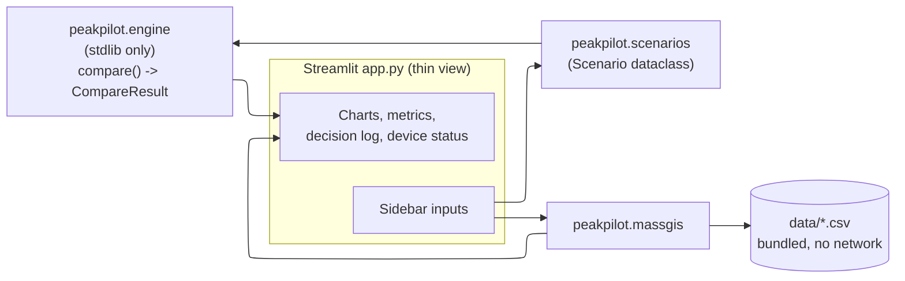
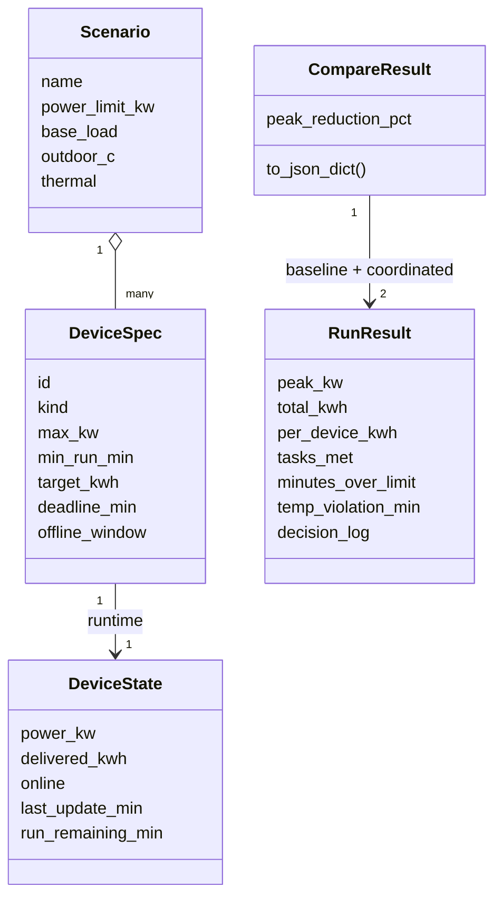
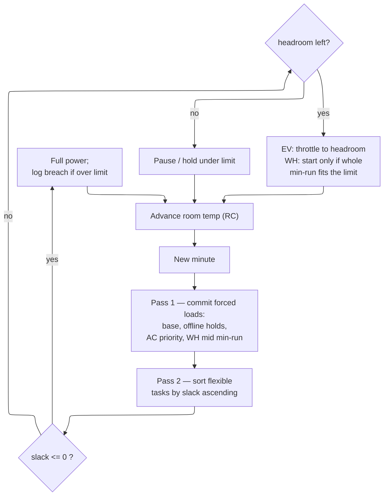
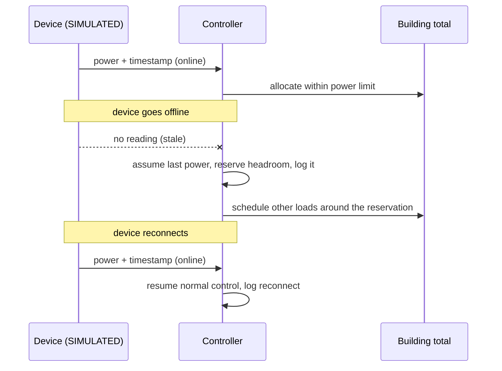

# PeakPilot — Design

Concise design for the 6–7 hour build. Validates requirements in `requirements.md`.

## Architecture

The dashboard is a thin view. All control logic lives in `engine.py`. The engine returns a
`CompareResult` the UI renders; it never reimplements scheduling. _Validates: Requirements 1.6, 5.*_

## Data model (engine)

- `DeviceSpec` — static config: `id`, `kind`, `max_kw`, `min_run_min`, plus kind-specific fields
  (EV: `target_kwh`, `deadline_min`; WH: `target_kwh`, `deadline_min`, `min_run_min`; AC: driven by thermal).
- `DeviceState` — per-step runtime: `power_kw`, `delivered_kwh`, `online`, `last_update_min`,
  `run_remaining_min`, supported commands. _Validates: Requirements 4.1._
- `Scenario` — `name`, `power_limit_kw`, device specs, base-load profile, outdoor-temp profile,
  thermal params (R, C, target_c), and optional offline window per device. _Validates: Requirements 1.4._
- `StepLog` — minute, total_kw, per-device kW, room_c; `DecisionEntry` — minute, device, message.
- `RunResult` — per-minute series + `peak_kw`, `total_kwh`, `per_device_kwh`, `tasks_met`,
  `minutes_over_limit`, `temp_violation_min`, `decision_log`. _Validates: Requirements 3.1._
- `CompareResult` — `baseline: RunResult`, `coordinated: RunResult`, `peak_reduction_pct`,
  `to_json_dict()`. _Validates: Requirements 1.*, 3.*._

## Thermal model (illustrative, documented)

Single first-order RC lump: `room_c[t+1] = room_c[t] + dt/C * ((outdoor_c - room_c)/R - ac_cooling_kw*eta)`.
Parameters chosen so an uncontrolled hot evening pushes the room over the comfort limit without the
AC, and the AC can hold it under the limit when given priority. Clearly labeled illustrative.
_Validates: Requirements 2.5, 3.1._

## Scheduling algorithm (least-slack-first)

Per minute:
1. Compute each flexible task's `slack = (deadline_min - now) - ceil(remaining_kwh / max_kw * 60)`.
2. Reserve power for any offline device at its last commanded level (disclose). _Validates: Requirements 4.2._
3. If room_c ≥ comfort − margin, give the AC priority (subject to min run). _Validates: Requirements 2.5._
4. Sort remaining tasks by slack ascending; allocate up to `power_limit - committed` greedily.
5. Any task with slack ≤ 0 runs at full power regardless of limit; record the breach. _Validates: Requirements 2.3._
6. Honor minimum run times before switching a device off. _Validates: Requirements 2.4._
7. Log only on state change. _Validates: Requirements 2.6._

Baseline run = every device pulls full power whenever it has remaining work, ignoring the limit.
Same workload and inputs as coordinated. _Validates: Requirements 1.4, 3.4._

## Key correctness properties

- **P1 Energy conservation:** per-device delivered kWh equals Σ(power_kw·dt) within float tolerance. _Validates: Requirements 1.3._
- **P2 Same work:** when both runs are feasible, total delivered kWh (baseline) == coordinated. _Validates: Requirements 3.4._
- **P3 Determinism:** `compare(s)` twice yields identical `to_json_dict()`. _Validates: Requirements 1.5._
- **P4 Feasible limit holds:** on a feasible scenario, coordinated `minutes_over_limit == 0`. _Validates: Requirements 2.1._
- **P5 Honest infeasible:** on an over-tight scenario, `minutes_over_limit > 0` and/or unmet energy reported, not hidden. _Validates: Requirements 3.2._

Offline-device handling (step 2 above), as an interaction over time:

## MassGIS loading

`massgis.py` reads `data/utilities.csv` (TOWN, UTILITY) and `data/landfills.csv`
(TOWN, SITE, TYPE, MW, STATUS, SINCE). Returns typed rows; blanks preserved as `None`/"—". No
generation inferred from MW. Provenance in `data/DATA.md`. _Validates: Requirements 6.*._

## Dashboard layout

Sidebar: scenario picker, power-limit slider (8–20 kW), EV kWh/deadline, WH kWh/deadline, town
selector, reset. Main: metric cards row → demand chart (baseline vs coordinated vs limit) → room-temp
chart → decision-log table → device-status panel → town/MassGIS panel. "SIMULATED" labels on
telemetry; source+date caption on MassGIS. _Validates: Requirements 5.*, 6.4._

## Dependencies (security note)

streamlit, pandas, plotly — all mainstream, actively maintained PyPI packages pinned to current
stable majors in `requirements.txt`. Engine core adds nothing beyond the stdlib, limiting the
runtime attack surface. No network calls at runtime.
