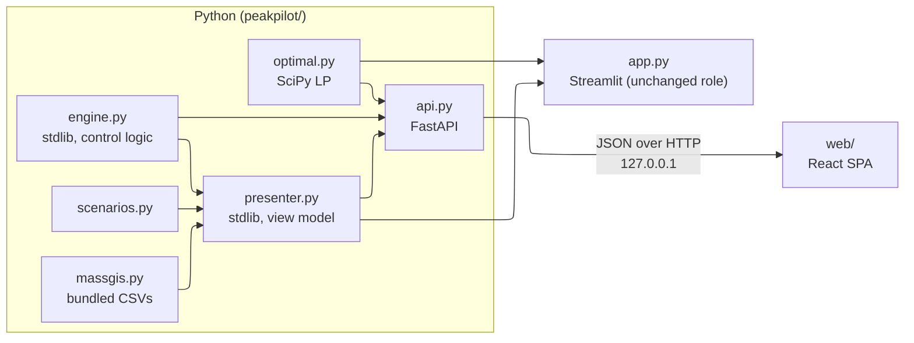
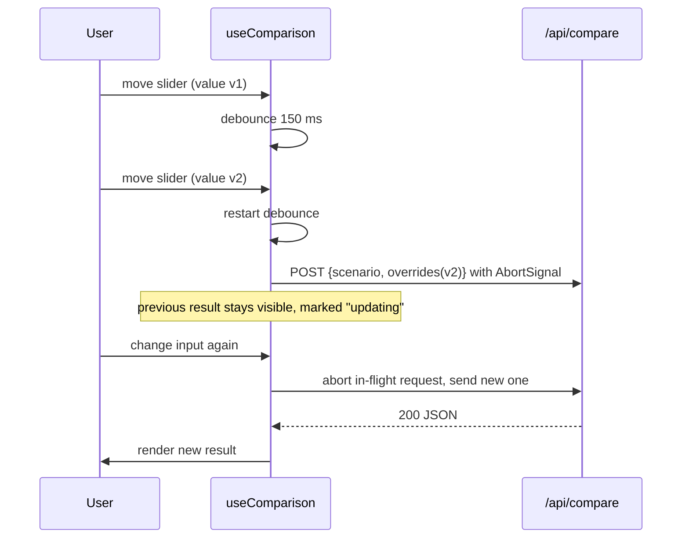

# React frontend — Design

Issue: [#20](https://github.com/sohampatwardhan/PeakPilot/issues/20). Validates `requirements.md` in this folder.

## Overview

Three layers, each one thinner than the one below it:

1. `peakpilot/presenter.py` (stdlib only) turns a scenario name plus overrides into a `Scenario`,
   and turns a `CompareResult` into a **view model**: the display fields `app.py` currently
   computes inline.
2. `peakpilot/api.py` (FastAPI) calls the presenter, `engine.compare()`, `optimal.benchmark()`
   and `massgis` and returns JSON. It contains no logic of its own beyond request validation.
3. `web/` (Vite + React + TypeScript) renders the JSON. It formats numbers and lays out panels.
   It never derives a metric.

`app.py` moves onto the presenter as well, so Streamlit and React show the same numbers from the
same code. `engine.py`, `optimal.py` and `massgis.py` are not changed.

Library versions (FastAPI, Uvicorn, httpx, React, Vite, TypeScript, Recharts, Vitest,
openapi-typescript) are pinned at implementation time. Their APIs are checked against Context7
docs then, not from memory.



## Presenter (`peakpilot/presenter.py`)

```python
@dataclass(frozen=True)
class InputSpec:
    key: str                  # "power_limit_kw" | "ev_kwh" | "ev_deadline_min" | "wh_kwh" | "wh_deadline_min"
    label: str                # e.g. "EV energy needed (kWh)"
    unit: str                 # "kW" | "kWh" | "min"
    default: float            # from the named scenario
    min: float
    max: float
    step: float
    options: tuple[tuple[int, str], ...] = ()   # deadlines only: (minutes after 16:00, "07:00")

def input_specs(scenario_name: str) -> list[InputSpec]: ...
def build_scenario(scenario_name: str, overrides: Mapping[str, float]) -> Scenario: ...
def validate_overrides(scenario_name: str, overrides: Mapping[str, float]) -> None: ...  # ValueError naming the key
def view_model(scenario: Scenario, cmp: CompareResult) -> dict: ...
def massgis_context(town: str) -> dict: ...   # KeyError on unknown town
def is_ac_cycling(message: str) -> bool: ...
```

**Override keys use engine units** (deadlines in minutes after 16:00), the same as the Rust CLI's
`--ev-deadline-min`. Only the UI layer shows clock times, and it takes the labels from
`InputSpec.options`, so neither Streamlit nor TypeScript does clock arithmetic.

**`build_scenario` keeps the scenario's environment** (R1.3, #19). It starts from the named
scenario and uses `dataclasses.replace` on `power_limit_kw` and on the EV and water-heater
`DeviceSpec`s (`target_kwh`, `deadline_min`). `base_load`, `outdoor_c`, `thermal`,
`offline_window` and `note` therefore carry over unchanged. `name` is set to the registry key,
which is what `app.py` passes today. This replaces the current `custom_scenario(...)` rebuild in
`app.py`, which resets `peak_outdoor_c` to 31 °C. If #19 is merged first with a different fix,
port that fix here instead.

**View model** (all values SIMULATED; numbers are raw floats, and the client rounds them):

```text
{
  "note": str,
  "metrics": {
    "coordinated_peak_kw", "baseline_peak_kw", "peak_reduction_pct",
    "energy": {"total_kwh", "baseline_total_kwh", "task_kwh", "baseline_task_kwh",
               "ac_kwh", "baseline_ac_kwh", "tasks_match": bool, "delta_text": str},
    "minutes_over_limit", "minutes_over_limit_delta", "all_tasks_met": bool
  },
  "infeasibility": [str, ...],        # empty list == feasible; same text as today's banner
  "devices": [{"id", "kind", "power_kw_end", "online": bool, "status_text",
               "last_update", "commands": [str], "delivered_kwh", "task_met": bool | null}],
  "decision_log": [{"time", "device", "message", "ac_cycling": bool}]
}
```

These rules move out of `app.py` as they are: AC-vs-task energy split via
`DeviceKind.AIR_CONDITIONER`, `tasks_match` within 0.05 kWh, the three delta strings, the
last-online search, and the `("cooling ON", "cooling OFF")` prefix test. `view_model` only reads
from `cmp` and `scenario`.

## API (`peakpilot/api.py`)

| Method | Path | Request | Response | Errors |
|---|---|---|---|---|
| GET | `/api/scenarios` | — | `[{name, note, inputs: [InputSpec]}]` | — |
| POST | `/api/compare` | `{scenario: str, overrides: {key: number}}` | `{compare, benchmark, view_model, diagnostics: {solve_time_s, compare_ms}}` | 422 unknown scenario / key / out of range |
| GET | `/api/massgis/towns` | — | `{towns: [str], default: "Boston"}` | — |
| GET | `/api/massgis/{town}` | — | `{town, utility, landfills: [...], source, portal_snapshot_date, retrieved_date, caveat}` | 404 unknown town |
| GET | `/` and assets | — | `web/dist` (only when it exists) | — |

- **Schemas.** Pydantic response models mirror `CompareResult.to_json_dict()`,
  `Benchmark.to_json_dict()` and the view model. FastAPI validates every response against them, so
  a shape change in Python fails fast instead of reaching the client.
- **Contract snapshot.** `python -m peakpilot.api --dump-openapi web/openapi.json` writes the
  schema. `tests/test_api.py` asserts `app.openapi()` equals the committed file. `web/` generates
  `src/api/schema.ts` from that file with openapi-typescript. The CI `web` job regenerates it and
  runs `git diff --exit-code`.
- **Validation.** Request models check types. `presenter.validate_overrides` checks ranges and
  deadline options. Both produce 422 with a `detail` naming the field (R2.3). Values are never
  clamped.
- **Imports.** `api.py` is the only module that imports FastAPI. `peakpilot/__init__.py` imports
  neither `api` nor `optimal`, so using only the engine still needs no third-party packages.
- **Runtime.** GZip middleware (~180 KB raw → ~47 KB). CORS only for the Vite dev origin, and
  only when `PEAKPILOT_DEV=1`. Uvicorn binds to `127.0.0.1` by default. No outbound calls.

## Web app (`web/`)

```text
web/
  package.json  package-lock.json  vite.config.ts  tsconfig.json  index.html
  openapi.json                         # committed contract snapshot (generated by the API)
  src/
    main.tsx  App.tsx  theme.css       # CSS variables, light + dark
    api/schema.ts                      # generated, do not edit
    api/client.ts                      # typed fetch wrappers, AbortSignal support
    hooks/useScenarios.ts  hooks/useComparison.ts  hooks/useMassgis.ts
    components/
      Controls.tsx                     # scenario picker, sliders, deadline selects, reset, town
      SimulatedBadge.tsx  InfeasibilityBanner.tsx  MetricCards.tsx
      DemandChart.tsx  TemperatureChart.tsx
      BenchmarkPanel.tsx  DecisionLog.tsx  DeviceStatus.tsx  MassGisPanel.tsx
    test/fixtures/{hot_evening,infeasible}.json   # real API output, generated by script
```

**Live updates (R3.3, R3.5).**



`useComparison` keeps `{data, status: "idle" | "updating" | "error", error}`. On error it keeps the
old data but marks it "out of date" with the error text, so stale numbers are never shown as
current.

**Charts.** Recharts `LineChart` with `isAnimationActive={false}`. The x-axis uses the server's
`clock` array, with ticks every 80 steps (≈12 ticks, matching Plotly's `nticks=12`). A
`ReferenceLine` draws the power limit and the comfort limit. Uncoordinated is red and dotted,
coordinated is green and solid, so color is never the only cue (R3.7). Each chart has a visually
hidden `<p>` summary: peak values, limit, minutes over (R3.7). Recharts is chosen over
`react-plotly.js` for bundle size, because Plotly.js adds about 1–3.5 MB for two line charts.

**Benchmark panel** renders the same state tree as `app.py`, from `benchmark.optimal.status`,
`limit_achievable` and `coordinated_comparable`. These flags come from `optimal.Benchmark`, so
React only branches on them.

**Formatting table.** The only place the client turns numbers into text:

| Field | Format | Matches `app.py` |
|---|---|---|
| peaks, LP bound, gap | `x.toFixed(1)` cards, `toFixed(2)` benchmark | yes |
| energy | `toFixed(0)` card, `toFixed(1)` help, `toFixed(2)` per device | yes |
| reduction % | `-${toFixed(0)}% vs base` | yes |

**Honesty components.** `<SimulatedBadge/>` is mandatory in the header of every simulated panel.
`MassGisPanel` sits after a divider, takes `source`, dates and `caveat` from the API response,
and never hardcodes them.

## Serving modes

| Mode | Commands | Notes |
|---|---|---|
| Dev | `PEAKPILOT_DEV=1 uvicorn peakpilot.api:app --reload` and `npm --prefix web run dev` | Vite proxies `/api` → `127.0.0.1:8000` |
| Local "prod" | `npm --prefix web ci && npm --prefix web run build`, then `uvicorn peakpilot.api:app` | one origin, works offline |
| Streamlit | `streamlit run app.py` | unchanged; still the submission path |

## Error handling

| Condition | Where | Behavior |
|---|---|---|
| Unknown scenario, unknown override key, out-of-range value, deadline not in options | presenter → API | 422 with `detail` naming the field |
| Unknown town | presenter → API | 404 |
| LP infeasible or solver error | `optimal` | 200, and `benchmark.optimal.status` says so; UI shows the matching message with no number |
| Engine raises (programmer error) | API | 500, and the traceback is logged server-side |
| Network failure, 5xx | web | error banner, previous result marked out of date |
| `web/dist` missing | API | `/api/*` works, and `/` returns 404 with a hint to run the build |

## Determinism

The engine and LP are already deterministic for identical input. The API keeps every
timing-dependent value in `diagnostics`. JSON is serialized with stable key order (dict
insertion order from `to_json_dict`). `tests/test_api.py` posts the same request twice and
compares the bodies with `diagnostics` removed.

## Correctness properties

- **P1, read-only presenter.** For every named scenario, `view_model` numbers equal the
  corresponding `CompareResult` fields (peaks, kWh, minutes over), and `engine.compare` output is
  unchanged by calling the presenter. _R1.5_
- **P2, environment preserved.** `build_scenario(name, {})` equals the registry scenario on every
  field except `name`. With overrides, only the overridden fields differ. _R1.3_
- **P3, ranges contain defaults.** For every scenario and input, `min ≤ default ≤ max`, and each
  deadline default is one of `options`. _R1.2_
- **P4, no silent clamping.** Every out-of-range value gets a 422, and in-range values are passed
  through exactly. _R2.3_
- **P5, deterministic responses.** Same request gives the same body minus `diagnostics`. _R2.5_
- **P6, contract pinned.** `app.openapi()` equals `web/openapi.json`, and `schema.ts` regenerates
  with no diff. _R3.6_
- **P7, labels present.** Every simulated panel renders "SIMULATED". The MassGIS panel renders
  the source and both dates. _R4.1, R4.2_

## Test plan

- `tests/test_presenter.py` (stdlib, always runs): P1–P3 parametrized over `scenarios.scenarios()`,
  `is_ac_cycling`, the three `delta_text` branches, the infeasible messages for the "Infeasible"
  scenario, and the offline EV's `status_text` and `last_update` in `ev_offline()`.
- `tests/test_api.py` (`pytest.importorskip("fastapi")`): every endpoint over `TestClient`, P4, P5,
  P6, 404/422 bodies, gzip, and the `web/dist` mount on a temp directory.
- `tests/test_web_fixtures.py`: `scripts/dump_web_fixtures.py --check` confirms the committed
  Vitest fixtures match current API output.
- `tests/test_app.py`: unchanged, and must still pass after `app.py` moves onto the presenter.
- `web/` Vitest + React Testing Library: P7, infeasibility banner on the infeasible fixture, every
  benchmark state (optimal, infeasible, error, limit not achievable, not comparable) via fixture
  edits, AC-cycling toggle off by default, reset restores defaults, superseded responses ignored
  (fake timers and mocked fetch).
- Manual: run each serving mode, step through all four scenarios side by side with Streamlit, and
  check with networking off.

## CI

`ci.yml` gains a `web` job (Node LTS, `actions/setup-node` with npm cache): `npm ci`,
`npm run gen:types && git diff --exit-code src/api/schema.ts`, `npm run typecheck`, `npm test`,
`npm run build`. The Python job installs the new pins from `requirements.txt` and adds `"fastapi"`
to the `engine.py` third-party import check. `rust.yml` and the Raspberry Pi image job are not
touched (the image is the Rust binary only).

## Docs and rules

- `tech.md`: add FastAPI (only in `api.py`) and React/Vite/TS (only in `web/`). Restate that
  neither layer holds control or honesty logic, and that the presenter is stdlib.
- `structure.md` and `AGENTS.md`: list `presenter.py`, `api.py`, `web/`, and the new tests. Add
  the boundary "React never derives metrics".
- `product.md`: add the React UI to In scope, still with no auth.
- `README.md`: a "React UI (optional)" section with the serving-mode commands. Streamlit stays the
  primary quick start until the user decides otherwise.
- `docs/DEMO_SCRIPT.md`: unchanged.

## Risks

| Risk | Mitigation |
|---|---|
| Two UIs drift apart | All derived values live in the presenter, and the contract snapshot fails on schema change |
| Refactoring `app.py` breaks the submission app | Presenter extraction is its own task, gated on `tests/test_app.py` passing before any React work |
| Fixing #19 changes Infeasible-scenario numbers in Streamlit | Expected and called out in the PR. No test asserts those values today |
| Coverage under 90% when FastAPI is missing locally | CI installs `requirements.txt`. `api.py` tests skip only where FastAPI is absent |
| Recharts looks different from Plotly | Accepted. Parity is about values and states, not pixels |
