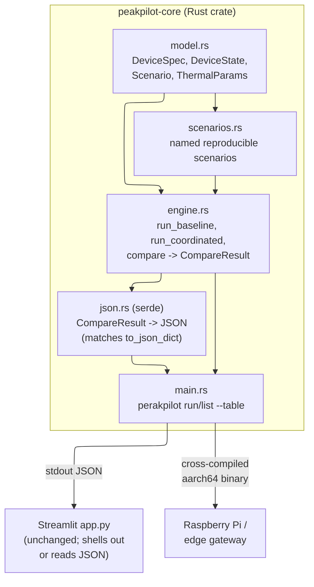
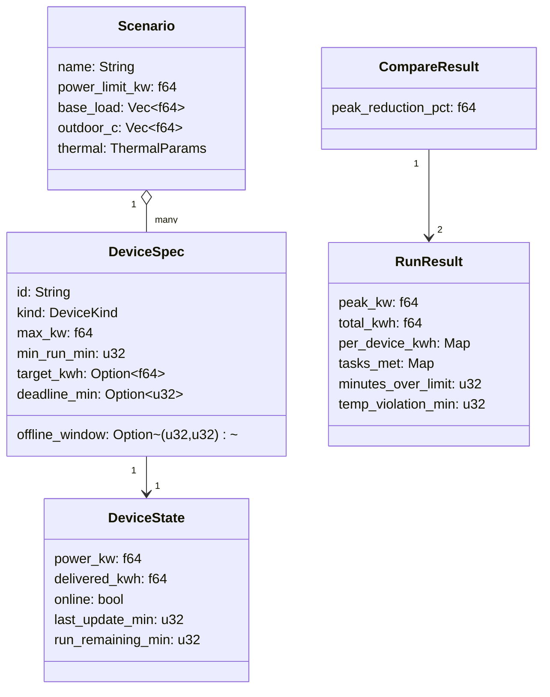
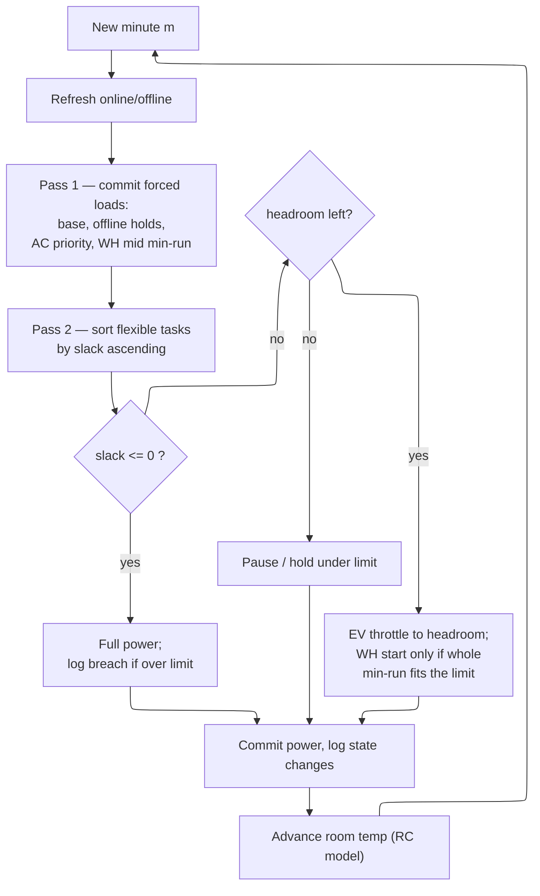
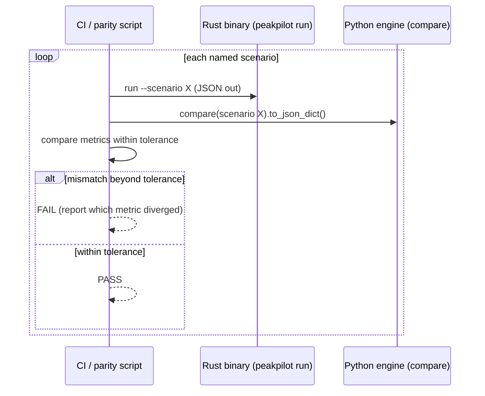
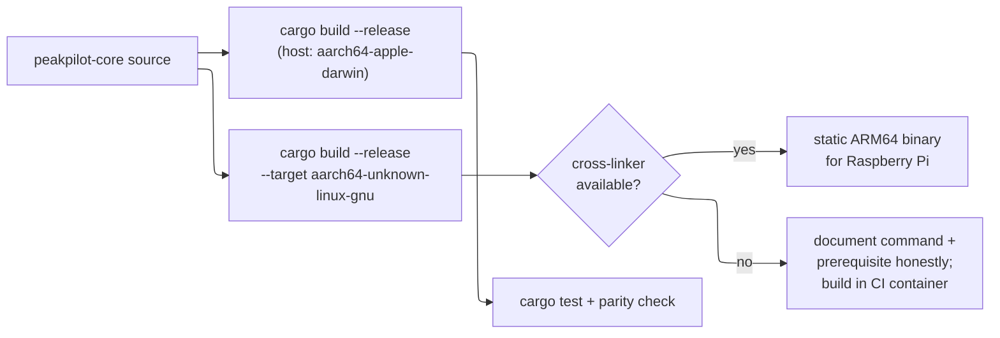

# Rust Engine Port — Design

Diagram-rich design for porting PeakPilot's engine to Rust. Validates requirements in
`requirements.md`. The Python engine is the oracle; the Rust crate must match it.

## Component architecture

Only `std` is used in `model/scenarios/engine` (the control path). `serde`/`serde_json`
are confined to `json.rs` and the CLI boundary. _Validates: Requirements 2.1, 2.2, 3.1_

## Module responsibilities

| Rust module | Mirrors Python | Responsibility |
|---|---|---|
| `model.rs` | `engine.py` dataclasses | Device specs/state, `Scenario`, `ThermalParams`, `RunResult`, `CompareResult` |
| `scenarios.rs` | `scenarios.py` | The four named scenarios + a custom builder |
| `engine.rs` | `engine.py` functions | `run_baseline`, `run_coordinated`, `compare`, thermal step |
| `json.rs` | `to_json_dict()` | serde serialization matching the Python JSON shape |
| `main.rs` | (new) | CLI: `run`, `list`, `--table` |

## Data model (mirrors the Python engine)

_Validates: Requirements 1.1, 3.1_

## Scheduler — identical two-pass least-slack-first loop

This is a line-for-line port of the Python algorithm; same ordering, same tie-breaks
(sort by `(slack, id)`), same minimum-run and start-gate rules. _Validates: Requirements 1.3, 7.1_

## Parity verification against the oracle

Tolerance is a documented absolute/relative epsilon on floating metrics; integer metrics
(minutes over limit, temperature-violation minutes, tasks met) must match exactly.
_Validates: Requirements 1.4, 6.1, 6.3_

## Floating-point parity risk

The main parity hazard is divergence between Python `float` and Rust `f64` accumulation
order. Mitigations:
- Keep the *same operation order* as Python (accumulate `delivered_kwh += power/60.0` per step).
- Compare metrics, not every raw sample, with a small epsilon (e.g. `1e-6` relative).
- Keep integer-valued metrics exact — they encode the honesty guarantees and must not drift.

_Validates: Requirements 1.4, 1.5_

## JSON contract

`json.rs` serializes `CompareResult` to the exact key set Python emits (`scenario_name`,
`power_limit_kw`, `comfort_c`, `peak_reduction_pct`, `baseline`, `coordinated`; each run with
`minutes`, `clock`, `total_kw`, `per_device_kw`, `room_c`, `power_limit_kw`, `peak_kw`,
`total_kwh`, `per_device_kwh`, `tasks_met`, `unmet_kwh`, `minutes_over_limit`,
`temp_violation_min`, `decision_log`). A golden JSON file pins the shape so either engine
drifting breaks CI. _Validates: Requirements 3.1, 3.2_

## Build & edge deployment

The `aarch64-unknown-linux-gnu` and `arm-unknown-linux-gnueabihf` targets are already
installed. Cross-linking from macOS needs an appropriate linker (e.g. a cross toolchain);
if unavailable locally, the ARM build is produced/verified in a Linux CI job and the exact
command + prerequisite are documented. We state honestly whether the binary was run on real
hardware. _Validates: Requirements 5.1, 5.2, 5.3_

## Dependencies (security note)

`serde` + `serde_json` are the only non-std crates — both are the de-facto standard Rust
serialization libraries, widely audited and actively maintained, pinned in `Cargo.toml`.
The control path (model/scenarios/engine) stays pure `std`, minimizing the edge attack
surface. No network access at runtime. _Validates: Requirements 2.1, 2.2_
