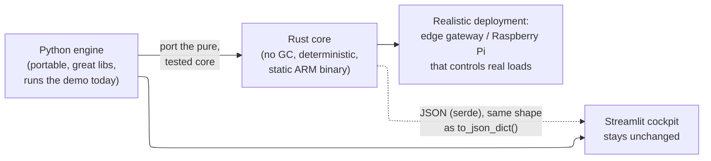

# Rust Engine Port — Requirements

Port PeakPilot's control engine from Python to a Rust crate (`peakpilot-core`) that is
**behaviourally identical**, suitable for edge deployment (Raspberry Pi), and verified
against the existing Python engine as an oracle. The Streamlit dashboard stays as-is and
consumes the Rust binary's JSON output.

> [!IMPORTANT]
> `main` keeps the working Python + Streamlit app as the guaranteed submission fallback.
> This work lands on a branch and is only merged if the Rust engine matches the oracle.

## Why

The control loop would realistically run as firmware on a constrained in-building
controller. Rust gives deterministic, memory-safe execution with a single static binary
and no runtime to ship — a stronger real-world story than a Python process, while the
Python engine remains the reference implementation and the dashboard's default.

## Requirements

### R1 — Behavioural parity with the Python engine

**Story:** As a developer, I want the Rust engine to produce the same results as the
Python engine so the port is trustworthy.

- R1.1 The Rust crate SHALL model the same three devices (EV throttleable, water heater
  on/off with min run, air conditioner thermal-driven) with the same parameters.
- R1.2 The Rust crate SHALL implement the same 16:00→08:00, 1-minute, 960-step window.
- R1.3 The Rust crate SHALL implement the same two-pass least-slack-first scheduler and the
  same first-order RC thermal model.
- R1.4 For every named scenario, the Rust metrics (peak kW, total/per-device kWh, tasks met,
  minutes over limit, temperature-violation minutes, peak reduction %) SHALL match the
  Python engine within a documented floating-point tolerance.
- R1.5 The Rust engine SHALL be deterministic: identical inputs produce identical output.

### R2 — Pure, dependency-light core

- R2.1 The core scheduling/thermal logic SHALL depend only on the Rust standard library.
- R2.2 Serialization MAY use `serde`/`serde_json` (edge-friendly, ubiquitous) — the only
  permitted non-std dependencies, and confined to the I/O boundary, not the control path.
- R2.3 The crate SHALL build on stable Rust.

### R3 — JSON output compatible with the dashboard

**Story:** As the Streamlit dashboard, I want the Rust binary's output to match the Python
`to_json_dict()` shape so I can render it without change.

- R3.1 The Rust binary SHALL emit a JSON object with the same keys and structure as the
  Python `CompareResult.to_json_dict()` (scenario_name, power_limit_kw, comfort_c,
  peak_reduction_pct, baseline, coordinated; each run with series + metrics + decision_log).
- R3.2 A JSON schema or golden file SHALL pin the contract so drift is caught.

### R4 — CLI surface

- R4.1 The binary SHALL run as `peakpilot run --scenario <name>` and print the comparison
  JSON (and, with `--table`, a human-readable summary).
- R4.2 `peakpilot list` SHALL print the available scenario names.
- R4.3 Exit code SHALL be non-zero on bad input.

### R5 — Edge / Raspberry Pi target

**Story:** As an operator, I want a single static binary I can drop onto a Pi-class device.

- R5.1 The crate SHALL cross-compile for `aarch64-unknown-linux-gnu` (64-bit Pi) — the
  installed target.
- R5.2 The README/spec SHALL document the exact cross-compile command and any linker
  prerequisite, and SHALL state honestly whether the ARM binary was built and how it was
  (or was not) verified on real hardware.
- R5.3 No runtime beyond the binary SHALL be required on the target (no Python, no libc
  surprises beyond the chosen target's standard expectations).

### R6 — Verified against the oracle (CI)

- R6.1 A parity check SHALL run both engines on all scenarios and assert matching metrics.
- R6.2 CI SHALL build and test the Rust crate (and run the parity check) on every push/PR.
- R6.3 Rust unit tests SHALL cover the same correctness properties as the Python suite
  (energy conservation, same-work, determinism, feasible-limit-holds, honest infeasibility).

### R7 — Honesty rules preserved

- R7.1 The Rust engine SHALL preserve every product honesty rule: report infeasibility
  (minutes over limit / temperature violations / unmet energy) rather than hide it; never
  reduce peak by dropping required work; keep telemetry labeled SIMULATED at the UI; no
  cost/carbon claims.
