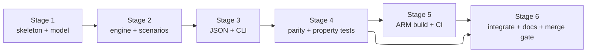

# Rust Engine Port — Tasks

Dependency-ordered plan. Lands on branch `feat/rust-engine`; merges only if parity passes.
Each task traces to requirements in `requirements.md`.

## Stage 1 — crate skeleton + model

- [x] 1.1 Create `rust/peakpilot-core` Cargo crate (lib + bin), stable Rust, `serde`/`serde_json` pinned. _Requirements: 2.1, 2.2, 2.3_
- [x] 1.2 Port the data model to `model.rs` (DeviceSpec/Kind, DeviceState, Scenario, ThermalParams, RunResult, CompareResult). _Requirements: 1.1, 3.1_

## Stage 2 — engine + scenarios

- [x] 2.1 Port profiles + the four named scenarios to `scenarios.rs`. _Requirements: 1.1, 1.2_
- [x] 2.2 Port the RC thermal step and `run_baseline` to `engine.rs`. _Requirements: 1.2, 1.3_
- [x] 2.3 Port the two-pass least-slack-first `run_coordinated` + `compare`. _Requirements: 1.3, 1.5, 7.1_
- [x] 2.4 Port metrics finalization (peak, kWh, tasks met, minutes over limit, temp violations). _Requirements: 1.4, 7.1_

## Stage 3 — JSON + CLI

- [x] 3.1 `json.rs`: serialize `CompareResult` to the exact Python `to_json_dict()` key set. _Requirements: 3.1, 3.2_
- [x] 3.2 `main.rs`: `peakpilot run --scenario <name> [--table]` and `peakpilot list`; non-zero exit on bad input. _Requirements: 4.1, 4.2, 4.3_

## Stage 4 — verification (the point of the whole exercise)

- [x] 4.1 Rust unit tests for the five correctness properties (energy conservation, same-work, determinism, feasible-limit-holds, honest infeasibility). _Requirements: 6.3, 7.1_
- [x] 4.2 Parity script: run Rust binary + Python engine on every scenario, diff metrics (ints exact, floats within epsilon). _Requirements: 1.4, 6.1_
- [ ] 4.3 Golden JSON file pinning the output contract. _Requirements: 3.2_

## Stage 5 — edge build + CI

- [x] 5.1 Document + attempt `cargo build --release --target aarch64-unknown-linux-gnu`; record command, linker prerequisite, and honest verification status. _Requirements: 5.1, 5.2, 5.3_
- [x] 5.2 Add a CI job: build/test the Rust crate and run the parity check on push/PR. _Requirements: 6.2_

## Stage 6 — integrate + document

- [ ] 6.1 Point the Streamlit app at the Rust binary's JSON (optional toggle; Python stays default/fallback). _Requirements: 3.1_
- [x] 6.2 README section: Rust core, edge/Pi story, parity results, how to build and cross-compile. _Requirements: 5.2_
- [ ] 6.3 Decide merge: only merge `feat/rust-engine` to `main` if parity + CI are green. _Requirements: 6.1, 6.2_

## Execution order

> [!CAUTION]
> Merge gate: if the Rust engine does not match the Python oracle within tolerance before
> the deadline, abandon the merge. `main` keeps the working Python + Streamlit submission.
