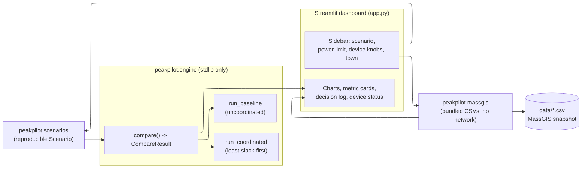
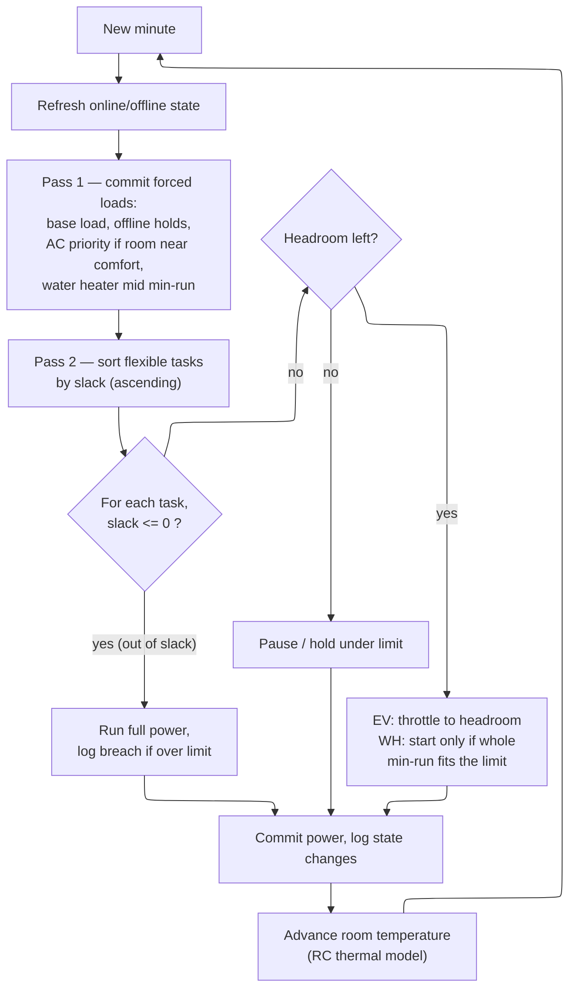
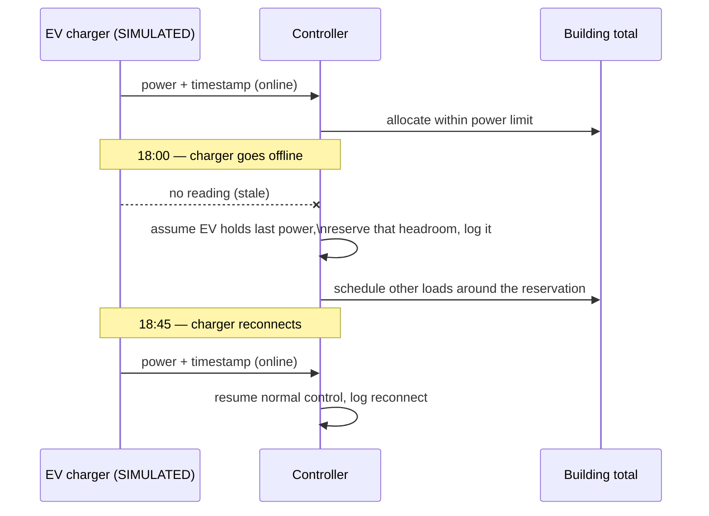
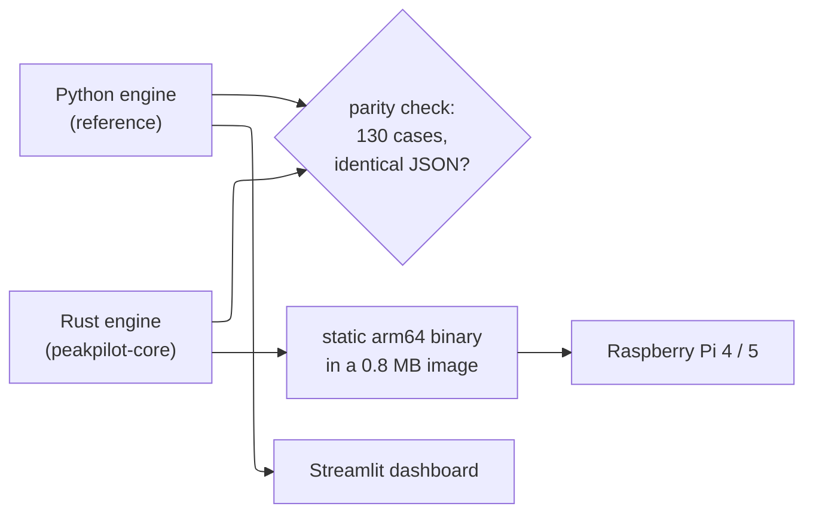

# PeakPilot

**A Massachusetts-aware building energy simulator that demonstrates IoT demand coordination — and makes the tradeoffs visible.**

PeakPilot is an IoT energy coordinator that cuts a building's peak electricity demand without cutting what gets done. Simulated smart devices (an EV charger, a water heater, and an air conditioner) report live power and room temperature. A deadline-aware controller decides which loads can wait and which can't, keeping the building under a power limit while still charging the car, heating the water, and keeping the room comfortable.

A dashboard runs the same evening twice — once without coordination, once with PeakPilot — and compares peak demand, energy delivered, deadlines met, and comfort, with a plain-language log of every decision. It handles devices going offline and flags when a limit can't be met instead of hiding it.

## Quick start

Requires Python 3.11+. No network or credentials needed — the MassGIS data is bundled.

```bash
git clone https://github.com/sohampatwardhan/PeakPilot.git
cd PeakPilot
python3 -m venv .venv && source .venv/bin/activate
pip install -r requirements.txt
streamlit run app.py
```

The dashboard opens in your browser. In the sidebar, pick a **scenario**, set the
**power limit** and device energy/deadlines, then read the before/after comparison.

Run the full test suite with coverage (what CI runs). The engine is pure standard
library; `tests/test_optimal.py` needs the SciPy pin from `requirements.txt`:

```bash
pip install -e ".[test]" -r requirements.txt
pytest -q --cov
```

| File | Covers |
|---|---|
| `tests/test_engine.py` | engine correctness properties |
| `tests/test_scenarios.py` | named scenarios are well-formed and deterministic |
| `tests/test_massgis.py` | bundled CSVs load offline, counts and dates match `data/DATA.md` |
| `tests/test_app.py` | headless dashboard smoke test (Streamlit `AppTest`) for every scenario, including the SIMULATED and MassGIS source labels |
| `tests/test_optimal.py` | LP benchmark properties (bound, energy, comfort, reproducibility) and the reactive floor |
| `tests/test_solar.py` | rooftop PV + MPPT: never above the true MPP or inverter rating, zero at night, net-load accounting, no-solar output unchanged |
| `tests/test_learn.py` | Hypothesis property tests for room-model calibration; reproduces the ML study results |

CI fails if coverage of `peakpilot/` drops below 90%. With only `pip install pytest`,
the engine, scenario and MassGIS tests still run and the dashboard test is skipped.

## Demo in 60 seconds

1. Start on **Hot evening (14 kW)**: the red uncoordinated run peaks at ~19 kW over the
   limit; the green coordinated run holds 14 kW (−26%), 0 minutes over, all deadlines met.
2. Switch to **EV offline 18:00–18:45**: the device panel marks the charger OFFLINE and the
   log shows the controller reserving its last power.
3. Switch to **Infeasible (8 kW, early EV deadline)**: the honesty banner reports the minutes
   over the limit instead of hiding them.
4. Change **Town** (e.g. Carver) to see its MassGIS electric utility and listed landfill
   renewable projects — public facts, kept separate from the simulation.

Full spoken walkthrough: [docs/DEMO_SCRIPT.md](docs/DEMO_SCRIPT.md).

## The problem

When several devices switch on together, they create a large demand peak. The peak, not total energy, is what strains the grid and drives demand charges. Some loads — a battery charger, a water heater — can wait briefly. PeakPilot answers one question:

> Which device can we delay, for how long, while still getting everything done?

This is the **C3 challenge** from the Hackachusetts 2026 Energy & climate tech track: *a more reliable clean energy system — clean power still has to show up at the peak.*

## How it works

1. **Measure** — Each simulated device reports power draw and (for the room) temperature, with an ID and timestamp.
2. **Decide** — A deterministic controller checks the building power limit, device deadlines, and the room temperature constraint.
3. **Act** — It throttles or defers flexible loads to stay under the limit.
4. **Explain** — The dashboard logs a reason for each action, e.g. `17:30 ev-1: throttled to fit power limit`.

### Architecture

The dashboard is a thin view. All control logic lives in a pure-standard-library engine,
so the same engine could drive a different front end or real devices later.



### Devices modeled

| Device | Constraint | Controller action |
|---|---|---|
| EV charger | Deliver a target energy (kWh) before a departure deadline | Throttle or pause charging |
| Water heater | Finish a heating task (kWh) before a deadline | Delay its start; respect a minimum run time |
| Air conditioner | Keep the simulated room below a comfort limit (°C) | Prioritize cooling when the room warms |

All device readings and thermal behavior are clearly labeled **SIMULATED**.

## Scheduling approach

The controller uses **least-slack-first** scheduling. Each task's slack is the time until its deadline minus the time it needs at full power. The task with the least slack gets power first. If a task runs out of slack, it runs at full power even if that breaks the limit, and the log records it.

Each one-minute step runs a two-pass allocation: commit the loads that cannot be throttled this minute, then distribute whatever headroom remains to the flexible tasks by slack.



Design principles:

- **Honest infeasibility.** When a limit cannot be met (for example, the AC must run to keep the room comfortable), the controller reports the minutes over the limit instead of hiding them.
- **Equipment-realistic behavior.** The water heater and air conditioner honor minimum run times so relays don't cycle every minute.
- **IoT failure handling.** When a device goes offline, the controller can't command it, assumes it holds its last power level, reserves that headroom, and defers other loads until it reconnects. A stale reading visibly changes the device's status.
- **Same work, lower peak.** Both runs deliver the same EV and water-heater energy, so peak reduction never comes from skipping work. AC energy can differ because coordination changes when the room is cooled (Hot evening: 12.25 kWh coordinated vs 11.08 kWh baseline). A lower peak achieved by leaving tasks unfinished counts as a failure, not a win.

### Offline device handling

When a device stops reporting, the controller cannot command it. Rather than guess, it
holds the device's last commanded power, reserves that headroom so it does not over-commit
the building, and discloses the assumption in the decision log until the device reconnects.



## Rooftop solar with MPPT

The **Sunny evening + rooftop PV (11 kW)** scenario adds a SIMULATED ~6 kW rooftop array to
the tight 11 kW case. The array follows an ideal single-diode I-V curve driven by an
illustrative clear-sky irradiance profile (Boston summer, sunrise 05:15, sunset 20:20) and a
NOCT cell-temperature model. Each minute the inverter runs a perturb-and-observe maximum
power point tracker (MPPT): it nudges the array voltage, keeps going while power rises, and
reverses when power falls. The engine checks the tracker against the true maximum power point
(golden-section search) and reports the tracking efficiency.

PV offsets demand, so the scheduler holds **net grid import** (base load + devices − PV)
under the limit. Both runs get the same PV. Scenarios without solar are unchanged. The
irradiance is not measured weather data and is never inferred from MassGIS installed capacity,
and no cost or emissions claims follow from it. The Rust engine ports the same PV and MPPT
model, and the parity check covers this scenario.

## How close to optimal?

A separate dashboard panel compares the coordinated peak with the lowest peak any schedule
could reach for the same scenario. `peakpilot/optimal.py` writes the scenario as one linear
program over the same 960 one-minute steps and solves it with SciPy's HiGHS solver (about
0.03 s per scenario). The LP must do the same work as the engine: every energy target by its
deadline, device power limits, the offline hold, and the room at or below the comfort limit
through the engine's own thermal model.

The framing is deliberately cautious:

- **Perfect foresight.** The LP knows the whole evening's base load and outdoor temperature
  in advance. The scheduler decides minute by minute.
- **Lower bound on achievable peak.** The LP lets the water heater and AC draw any power
  between 0 and their maximum, while the engine switches them fully on or off with minimum
  run times. A real schedule may not reach the bound.
- **Infeasible means no number.** If no schedule can meet every deadline and the comfort
  limit, the panel says so instead of showing a figure.
- **Reactive floor, not the gap to your limit.** The headline compares the bound with the
  lowest limit the scheduler can hold with every deadline met, 0 minutes over and the room in
  comfort (a 0.1 kW sweep of the real engine). On Hot evening that floor is 7.8 kW against a
  6.03 kW bound: 1.77 kW of headroom, not the 7.97 kW gap to the 14 kW limit you chose. In the
  EV-offline scenario feasibility is not monotone in the limit, and the panel says so.
  No cost or emissions claims follow from either number.

### Where machine learning fits (analysis, not control)

Two SciPy models in `peakpilot/learn.py` sit beside the scheduler, never in place of it:

- **Calibrate the room model.** An output-error least-squares fit recovers the thermal model
  from thermostat-style telemetry (SIMULATED here, with 0.2 °C sensor noise) to within 0.5 %.
  A sidebar toggle runs both evenings on the fitted model. A real building would supply its
  own thermostat and AC-meter data.
- **What if the forecast is wrong?** The LP plans on a wrong base-load or outdoor forecast and
  the plan is played against the true evening. Good forecasts beat the reactive floor by
  1.0–1.7 kW; 0.5 kW of noise erases the gain, and a forecast 2 °C too cool breaks comfort for
  462 minutes. That is why PeakPilot's control stays reactive.

- **What is rooftop PV worth?** Study S4 finds the MPPT tracker captures 99.97 % of the
  true-MPP energy. PV lowers the scheduler's reactive floor from 7.8 to 7.3 kW, then stops,
  because the binding minutes come after sunset. The LP bound keeps falling, so PV makes
  forecast-aware scheduling more valuable.

The research behind these, including a MATLAB R2026b cross-check that matches SciPy to ~1e-8,
is in `studies/` (`ml_studies.ipynb`). It runs on a development machine
only: the app does not import it, and judges do not need MATLAB.

## Massachusetts context

PeakPilot adds a local planning layer from MassGIS (via the Hackachusetts climate portal). The user journey: **select a town → see its electricity context → simulate a building → compare coordinated vs. uncoordinated demand.**

| Dataset | Role | Limit |
|---|---|---|
| [Electric utility by town](https://hackachusetts2026.vercel.app/kits/utilities.zip) | Name the utility that serves the selected town | No tariffs, live demand, or grid capacity |
| [Renewables at Massachusetts landfills](https://hackachusetts2026.vercel.app/kits/landfills.zip) | Show listed renewable projects in that town (status, reported capacity) | Reported capacity is not actual generation available to the building |

The relationship is kept honest: **MassGIS describes the local infrastructure; the simulation tests building-level demand coordination.** Source links and the dataset snapshot date (tables saved 2026-10-18) are shown in the app.

## What the demo shows

Run the same scenario twice and compare:

| Metric | What it demonstrates |
|---|---|
| Peak power (kW) | Whether coordination reduced simultaneous demand |
| Peak reduction (%) | Size of the improvement |
| Energy delivered (kWh) | Whether both runs completed equivalent work |
| Tasks met | Whether deadlines were honored |
| Minutes over limit | Whether, and how honestly, the limit held |

Three scenarios make it compelling:

- **Demand spike** — the controller postpones the flexible load.
- **Room warms** — the air conditioner gets priority.
- **Device offline** — local control continues and the dashboard marks readings as stale.

## Scope

This prototype deliberately includes:

- One building, three devices, one deterministic scheduling rule
- Two bundled MassGIS datasets for local context
- A before-and-after comparison with a decision log

And deliberately excludes:

- Authentication, custom electronics, and live utility integrations
- Machine-learning control (the scheduler is rules-based and explainable)
- Carbon or cost savings claims (reducing peak demand does not by itself reduce total energy or emissions)

## Assumptions and limitations

- **All device telemetry is simulated.** PeakPilot does not connect to or control real
  equipment. Readings carry an ID and timestamp so a real sensor/controller could later
  implement the same interface, but nothing here is a live measurement.
- **The thermal model is illustrative.** The room is a single first-order RC lump tuned so a
  hot evening is interesting; it is not a calibrated model of any real building.
- **The scheduler is deterministic and rules-based** (least-slack-first). Same inputs → same
  output. No learning, no randomness in the control path.
- **MassGIS data describes infrastructure only.** It does not establish live grid demand,
  available capacity, electricity price, carbon intensity, or which generator supplies a
  building. Reported landfill capacity (MW) is **not** generation.
- **No cost or carbon savings are claimed.** Reducing a peak does not by itself reduce total
  energy or emissions, and we have no data to support such claims.
- **Rooftop PV is illustrative.** The irradiance curve is clear-sky and synthetic, the array
  is an ideal single-diode model, and the MPPT is a textbook perturb-and-observe loop. It is a
  demonstration of net-load coordination, not a production forecast.
- **Offline handling is an explicit assumption:** an offline device is assumed to hold its
  last commanded power, and that assumption is disclosed in the decision log.

## Rust engine for the Raspberry Pi

A load controller like this would run on a small computer inside the building, not on a
laptop. `rust/peakpilot-core` is a port of the Python engine to Rust that compiles to a
single static binary for a Raspberry Pi 4 or 5 (64-bit Raspberry Pi OS). It has no garbage
collector and needs no runtime on the device. The scheduling code uses only Rust's standard
library; `serde` is used only to write JSON.

The Python engine is the reference. CI runs both engines on every named scenario (including
rooftop PV with MPPT) plus 125 seeded random variations and compares the full JSON output: every per-minute value, every
metric, every decision-log line. They currently match exactly on all 130 cases. Getting
identical numbers required reproducing Python's compensated float `sum()` in Rust.



### Run it

```bash
cd rust/peakpilot-core
cargo run --release -- list
cargo run --release -- run --scenario hot_evening --table
cargo run --release -- run --scenario hot_evening --limit 12 --ev-kwh 40   # JSON out
```

### Build the Raspberry Pi image

```bash
docker buildx build --platform linux/arm64 -t peakpilot:arm64 --load rust/peakpilot-core
docker run --rm peakpilot:arm64 run --scenario hot_evening --table
```

The image holds only the binary (built on `scratch`) and runs as an unprivileged user.
Building on an arm64 machine compiles natively; on an x86 machine Docker emulates arm64,
which is slower. To get just the binary for copying onto a Pi:

```bash
docker buildx build --platform linux/arm64 --output type=local,dest=dist rust/peakpilot-core
scp dist/peakpilot pi@raspberrypi.local:~/
```

**Verification status:** the arm64 image has been built and run on an Apple silicon Mac and
is built and smoke-tested in CI on a GitHub arm64 runner. It has **not** been run on a
physical Raspberry Pi. The Pi 4 and 5 both use 64-bit Arm cores, so the same image should
run on either.

### Testing

- **Property-based tests** (`proptest`, 256 generated scenarios per property) check that
  power stays within each device's rating, delivered energy equals the integral of the
  power series, deadlines count only energy delivered before them, the building total
  equals base load minus PV plus device draw, and identical inputs give identical results.
- **Scenario tests** mirror the Python suite on the five named scenarios, including PV bounds and
  net-load accounting. The property tests randomly switch rooftop PV on and off.

The property tests found two bugs that also existed in the Python engine; both are fixed
in both engines:

1. A task was marked "met" if its energy arrived by 08:00, even when it missed its own
   deadline. Now only energy delivered before the deadline counts, and the rest is
   reported as unmet.
2. A device that went offline kept drawing power after reaching its target, and the
   reported building total included the headroom the controller had reserved for it.
   Now an offline device stops at its target, and the total reports actual draw.

## Project structure

```
app.py                  Streamlit dashboard (thin view over the engine)
peakpilot/engine.py     simulation + least-slack-first scheduler + PV/MPPT model (stdlib only)
peakpilot/scenarios.py  named reproducible scenarios
peakpilot/massgis.py    bundled MassGIS loader (no runtime network)
peakpilot/optimal.py    perfect-foresight LP peak benchmark + reactive floor (SciPy)
peakpilot/learn.py      room-model calibration + forecast-error cost (SciPy; analysis only)
rust/peakpilot-core/    Rust port of the engine + CLI + Raspberry Pi Dockerfile
scripts/parity_check.py Python vs Rust output comparison (run in CI)
data/                   MassGIS CSVs + DATA.md provenance
tests/                  pytest suite (engine, scenarios, MassGIS, dashboard smoke, LP benchmark, learn)
studies/                ML research notebook + study scripts + MATLAB cross-check (dev only)
.kiro/                  steering, specs, and the Kiro usage write-up
docs/                   demo script + submission checklist
```

See [AGENTS.md](AGENTS.md) for contributor/agent conventions and
[.kiro/KIRO_USAGE.md](.kiro/KIRO_USAGE.md) for how Kiro was used.

## Data sources and attribution

- Challenge and datasets: [Hackachusetts 2026 — Energy & climate tech](https://hackachusetts2026.vercel.app/#/climate)
- Electric utility by town and Renewables at Massachusetts landfills: MassGIS, Commonwealth of Massachusetts (confirm layer terms). Tables snapshot 2026-10-18.

All device telemetry and thermal behavior in PeakPilot is **simulated** and labeled as such.
